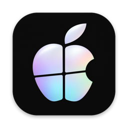
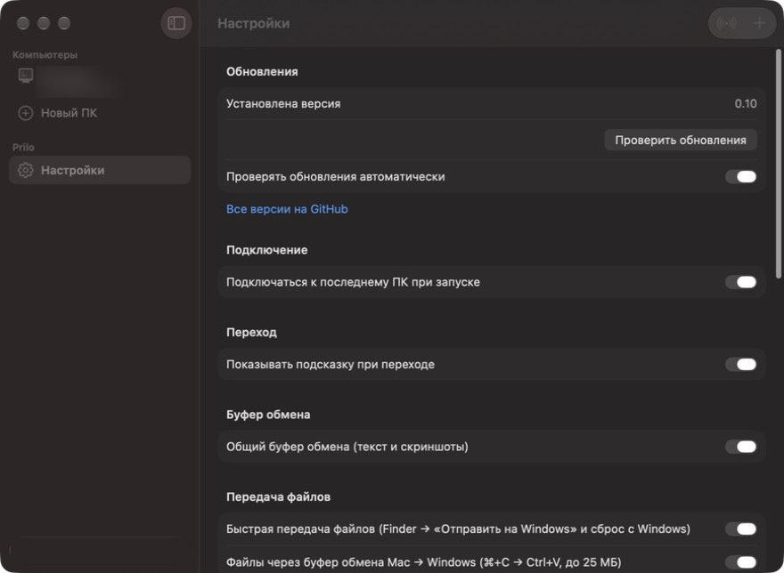
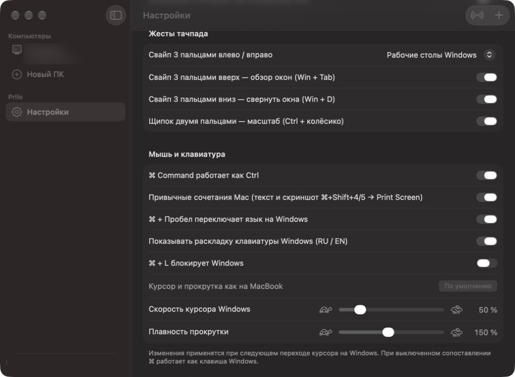
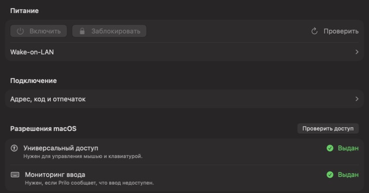

<p align="center">
  
</p>

# Prilo

Приложение для MacBook и приёмник для Windows. При расположении монитора Windows над MacBook курсор переходит на него через верхнюю кромку. Положение по горизонтали сохраняется пропорционально ширине экрана. Для возврата толкните курсор вниз через нижнюю кромку основного монитора Windows или нажмите **Ctrl + Option + Esc** на Mac.

Кроме мыши и клавиатуры Prilo синхронизирует буфер обмена (текст и картинки), передаёт файлы в обе стороны, переводит жесты тачпада и привычные сочетания Mac в их аналоги на Windows и умеет включать и блокировать ПК.

<p align="center">
  
</p>

## Возможности

- **Курсор и клавиатура.** Курсор переходит на монитор Windows через верхнюю кромку MacBook. ⌘ по умолчанию работает как Ctrl, Option как Alt. Скорость курсора и плавность прокрутки настраиваются, скорость по умолчанию 50 %.
- **Буфер обмена.** Скопированный текст и скриншоты появляются на другом компьютере.
- **Передача файлов.** В Finder выбери «Отправить на Windows», а с Windows файлы сбрасываются на Mac. Файлы до 25 МБ можно передавать через буфер обмена: ⌘C на Mac, Ctrl+V на Windows. Полученные файлы помечаются как скачанные с другого компьютера, существующие не перезаписываются.
- **Жесты тачпада.** Свайп тремя пальцами влево и вправо переключает рабочие столы Windows, вверх открывает обзор окон (Win + Tab), вниз сворачивает окна (Win + D). Щипок масштабирует (Ctrl + колесо).
- **Сочетания Mac.** Скриншот через ⌘ + Shift + 4/5 открывает Print Screen, ⌘ + Пробел переключает язык. При смене раскладки на Windows появляется подсказка RU / EN. ⌘ + L может блокировать Windows (по умолчанию выключено).
- **Питание и VPN.** Prilo включает ПК через Wake-on-LAN, блокирует Windows и включает или выключает VPN в Happ на ПК. Есть [плагин для Homebridge](homebridge/README.md) и Apple «Дома».

<p align="center">
  
</p>

Синхронизация буфера, файлов, жестов и сочетаний работает, когда и Mac, и приёмник Windows обновлены до 0.10 или новее. Со старой версией на другой стороне управление мышью и клавиатурой работает как раньше.

## Скачать

Готовые файлы лежат на странице [Releases](../../releases/latest):

- `Prilo-Mac.zip` — приложение для Mac (macOS 14+). Распакуй и перенеси `Prilo.app` в `~/Applications` или `/Applications`. Сборка подписана собственным сертификатом и не заверена Apple, поэтому при первом запуске macOS её заблокирует: открой «Системные настройки» → «Конфиденциальность и безопасность» и нажми **«Открыть всё равно»**. Это нужно сделать один раз.
- `PriloReceiver.exe` (x64) или `PriloReceiver-arm64.exe` (ARM64) — приёмник для Windows. Windows SmartScreen может предупредить о неизвестном издателе: нажми «Подробнее» → «Выполнить в любом случае».
- [`prilo-receiver` на PyPI](https://pypi.org/project/prilo-receiver/) — второй вариант приёмника для Windows. Пакет запускается через Python 3.9+ и включает нативный Go-приёмник для x64 или ARM64. Устанавливай один из двух вариантов и запускай только один приёмник одновременно.

### Приёмник через Python

На Windows открой PowerShell и установи или обнови пакет:

```powershell
python -m pip install --upgrade prilo-receiver
if ($LASTEXITCODE -eq 0) { python -m prilo_receiver }
```

Оставь PowerShell открытым. Приёмник покажет одноразовый код. На Mac выбери **«Найти ПК в сети»**, открой найденный ПК и введи код. В PowerShell клавиша Enter выдаёт новый код, а Ctrl+C останавливает приёмник.

Если список ПК пуст, останови приёмник и запусти его в ручном режиме (доступен в `0.9.1`):

```powershell
python -m prilo_receiver --manual
```

Режим покажет IPv4-адреса Windows, код доступа и отпечаток сертификата. На Mac введи IPv4-адрес сетевого адаптера, через который ПК доступен с Mac, и скопируй код доступа и отпечаток в одноимённые поля. Затем нажми **«Подключить Windows»**. Для ручного подключения Mac должен иметь доступ к порту TCP 43821 на Windows. Вводи код доступа только в Prilo.

Python-приёмник работает в текущем сеансе Windows, а обновления устанавливаются через `pip`. Меню в трее, встроенный автозапуск и самообновление доступны в EXE-версии. Пример использования из Python и описание пакета есть в [документации Python-приёмника](python/README.md).

## Запуск

1. Подключи Mac и Windows к одной локальной сети.
2. На Windows запусти EXE для своей архитектуры или Python-приёмник. Если брандмауэр спросит, разреши доступ для частной сети. EXE работает в фоне и показывает значок в трее. Python-приёмник выводит код в терминал. Оба варианта используют TCP 43821 для подключения и Bonjour (mDNS) для поиска.
3. На Mac открой `Prilo.app`, разреши доступ к локальной сети и выбери **«Найти ПК в сети»**. Выбери ПК и вставь код сопряжения. В EXE код можно открыть через **«Код сопряжения…»** в трее, а новый получить через **«Новый код сопряжения»**. Код одноразовый и действует 10 минут. Уже сохранённые профили можно использовать сразу. Для ручного подключения возьми данные из меню EXE или через `--manual` у Python-приёмника.
4. Если Prilo сообщает, что нужен доступ к вводу, нажми **«Открыть „Универсальный доступ“»**, включи Prilo и вернись в приложение.
5. Когда появится «управление готово», доведи курсор до верхней кромки MacBook и продолжи движение вверх.

### Автозапуск EXE на Windows

Размести приёмник в постоянной папке, например `%LOCALAPPDATA%\Prilo`. Затем включи автозапуск одним из способов:

- в меню значка Prilo в трее отметь **«Запускать при входе в Windows»**;
- или открой PowerShell в папке приёмника и один раз выполни `.\PriloReceiver.exe --enable-autostart` (для ARM64 подставь имя ARM64-версии).

После входа в этот аккаунт Windows приёмник запускается в фоне, без окон, и появляется в трее. `--disable-autostart` или снятая галочка убирают автозапуск. Если переместишь exe в другую папку, включи автозапуск заново. Меню в трее также показывает данные для ручного подключения, открывает журнал (`%LOCALAPPDATA%\Prilo\receiver.log`) и завершает приёмник. Чтобы значок всегда был виден, перетащи его из скрытых значков на панель задач.

Если Mac находит ПК через «Найти ПК в сети», но подключение или «Проверить» заканчивается тайм-аутом, порт блокирует брандмауэр Windows. Так бывает после переноса exe в другую папку: старое разрешение привязано к прежнему пути. Выбери в меню значка **«Разрешить в брандмауэре…»** и подтверди запрос администратора. Prilo добавит правило для TCP 43821 в частных сетях. Сеть Windows должна быть отмечена как «Частная».
Передаются левые, правые и средние клики, перетаскивание, вертикальная и горизонтальная прокрутка, клавиши и модификаторы. Command по умолчанию соответствует Ctrl, Option — Alt. Например, для копирования используй ⌘C. Символы определяет активная раскладка Windows.

В этой версии переход настроен на один основной монитор Windows, расположенный сверху. Мультимедийные клавиши, ввод на экране блокировки и защищённый экран UAC пока не поддерживаются. Экран Windows виден на физическом мониторе.

## Настройки и сохранённые ПК

- Успешное подключение сохраняет ПК в боковой панели. Используй «Добавить ПК», чтобы сохранить другой. Переименовать ПК можно кнопкой «Переименовать» на его странице или через контекстное меню в боковой панели. Один ПК управляется в каждый момент времени. По умолчанию при следующем запуске Prilo подключается к последнему успешному ПК.
- При смене IP Prilo ищет сохранённый ПК по отпечатку сертификата в локальной сети. Если Bonjour недоступен, IP можно обновить вручную.
- В «Настройках» можно отключить автоподключение, подсказку при переходе, общий буфер обмена и передачу файлов, выбрать действия для жестов тачпада, изменить скорость курсора и плавность прокрутки, переключить ⌘ с Ctrl обратно на клавишу Windows и включить блокировку Windows по ⌘ + L.
- При переходе Prilo показывает короткую подсказку у края экрана Mac. При системной настройке уменьшения движения подсказка появляется без движения.
- При первой установке сборки с постоянной подписью macOS может попросить доступ заново. Добавь в «Универсальный доступ» копию из `~/Applications/Prilo.app`. Если появится запрос Связки ключей для уже сохранённых профилей, выбери «Всегда разрешать».

## Управление и диагностика

- Кнопка «Приостановить управление» сохраняет соединение и отключает переход через край. Кнопка «Отключить Windows» закрывает соединение.
- Закрытие окна оставляет Prilo в строке меню. Для полного выхода нажмите ⌘Q или «Выйти из Prilo». Если мышь и клавиатура на Windows, сначала нажмите Ctrl + Option + Esc.
- Для диагностики нажмите «Скопировать журнал». «Показать файл» открывает журнал в Finder. Файл `~/Library/Logs/Prilo/prilo.log` ротируется при достижении 256 КБ. Приложение хранит текущий и предыдущий журналы. Оно записывает результаты сетевых запросов, наличие разрешений и переключения ввода. Код доступа, отпечаток, IP и события мыши и клавиатуры в журнал не попадают.

## Питание, VPN и Apple «Дом»

<p align="center">
  
</p>

1. Обнови Prilo на Mac и запусти новый приёмник на Windows. Он использует ту же локальную пару ключей, что и 0.6. После загрузки Windows приёмник должен быть запущен для проверки статуса и блокировки. Для автозапуска используй `--enable-autostart`.
2. В Prilo выбери сохранённый ПК в боковой панели. Кнопки **«Включить»**, **«Заблокировать»** и **«Проверить»** находятся в разделе **«Питание»** на странице ПК. Prilo получает **MAC** и **Broadcast** от нового приёмника при подключении. Чтобы выбрать другой адаптер, раскрой **«Wake-on-LAN»**, введи значения из его строки `Wake-on-LAN` и сохрани.
3. **«Включить»** отправляет magic packet и ждёт подтверждения от приёмника до 45 секунд. Для пробуждения обычно нужен Ethernet и соответствующая настройка BIOS/UEFI и драйвера. Поддержка пробуждения из полного выключения зависит от ПК. **«Заблокировать»** блокирует Windows (как Win + L). Открытые приложения продолжают работать.
4. Для Apple «Дома» установи [плагин в Homebridge](homebridge/README.md). Мост должен работать на устройстве, которое остаётся включённым, пока Windows-ПК выключен. Переключатель проверяет доступность приёмника. Если приёмник не запущен, достоверно определить состояние питания через этот переключатель нельзя.
5. Раздел **«VPN на Windows»** на странице ПК передаёт команды включения и выключения VPN клиенту Happ на Windows. Установи Happ для Windows и выбери в нём профиль. Команда применяется к этому профилю, а фактическое состояние туннеля показывает сам Happ. Чтобы Prilo не терял связь с ПК при включённом VPN, в Happ должен быть включён обход локальной сети. Нужны Prilo и приёмник 0.10.1 или новее.

## Обновления

- **Mac:** Prilo раз в сутки проверяет новую версию на GitHub. Когда она есть, в «Настройках» появляется отметка, а в строке меню — пункт «Установить Prilo …». Кнопка **«Установить и перезапустить»** скачивает архив, проверяет, что он подписан тем же сертификатом, что и установленная копия, заменяет приложение и перезапускает его. Проверить вручную можно кнопкой **«Проверить обновления»** в «Настройках» или пунктом меню «Проверить обновления…». Автоматическую проверку можно отключить там же.
- **Windows EXE:** приёмник проверяет обновления через минуту после запуска и затем раз в сутки. Вручную — пункт **«Проверить обновления…»** в трее. После согласия приёмник скачивает exe, сверяет его SHA-256 с контрольной суммой GitHub, заменяет себя и перезапускается. Папка приёмника должна быть доступна для записи (например, `%LOCALAPPDATA%\Prilo`).
- **Windows Python:** останови приёмник через Ctrl+C и выполни `python -m pip install --upgrade prilo-receiver`.

### Что изменилось в Python-приёмнике 0.9.1

- Ручной режим показывает IPv4-адреса Windows, код доступа и полный отпечаток сертификата. Он доступен через `python -m prilo_receiver --manual` или метод `Receiver.connection_details()`.
- Номер версии при запуске совпадает с версией установленного пакета.
- Python и EXE используют один Go-приёмник и общие данные сопряжения для одного аккаунта Windows. При штатной остановке приёмник закрывает сеанс ввода и прекращает объявлять себя в локальной сети.

## Выпуск новой версии

1. Один раз: `brew install gh`, `gh auth login` и `./scripts/sign-mac.sh init`. Папку `~/Library/Application Support/Prilo/Signing` с ключом подписи нельзя терять и нельзя класть в репозиторий: обновления, подписанные другим ключом, Mac-приложение отклонит.
2. Закоммить изменения в `main`, затем запусти `scripts/release.sh 0.10.1` (можно добавить файл с описанием: `scripts/release.sh 0.10.1 notes.md`; без него GitHub соберёт описание из коммитов).
3. Скрипт поднимает версию в `mac/Info.plist`, прогоняет `scripts/check.sh`, собирает всё через `./build.sh`, создаёт коммит и тег `v0.10.1`, отправляет их на GitHub и публикует релиз с файлами из `dist`. Установленные копии Prilo увидят его при следующей проверке.

Репозиторий для обновлений задаёт ключ `PriloUpdateRepository` в `mac/Info.plist`; `build.sh` передаёт его и версию в сборку приёмника.

### Локальная установка на Mac без релиза

Для обновления своей копии из исходников собери Mac-версию командой `./build.sh --mac-only`, закрой Prilo и запусти `./scripts/update-mac.sh`. Установщик проверяет подпись и заменяет копию в `~/Applications/Prilo.app`. Если там лежит старая сборка с временной подписью, для первого перехода используй `./scripts/update-mac.sh --adopt-adhoc`. При первой установке сборки с постоянной подписью macOS может снова попросить доступ к «Универсальному доступу».

## Сборка

Приложение для Mac работает на macOS 14 и новее. На macOS 26+ окно использует оформление Liquid Glass. На Mac с Apple Silicon установите Xcode Command Line Tools и Go 1.24 или новее. Запустите `./build.sh`. В `dist` появятся приложение, архив для Mac и обе сборки для Windows. Если установлен Node.js с npm, скрипт также упакует плагин Homebridge в `.tgz`.

Для сборки Python-пакета нужны Go, LLVM-MinGW и модуль Python `wheel`. Добавь LLVM-MinGW в `PATH` и запусти `PRILO_PYTHON_VERSION=0.9.1 bash scripts/build-python.sh amd64 arm64`. Файлы `.whl` появятся в `dist/python`. Версия Python-пакета выпускается отдельно от приложения на Mac и Windows EXE.

## Проверка

Перед сборкой запусти `./scripts/check.sh`. Скрипт проверяет код приёмника для Windows и запускает его тесты на Mac (ввод Windows заменён заглушками), проверяет типы Mac-приложения и выполняет его логические тесты (`./scripts/test-mac.sh`), а затем тесты плагина Homebridge (`npm test` в `homebridge`). Логика Mac без AppKit находится в `mac/Protocol.swift` и `mac/InputProcessing.swift`, тесты лежат в `mac/Tests`.
